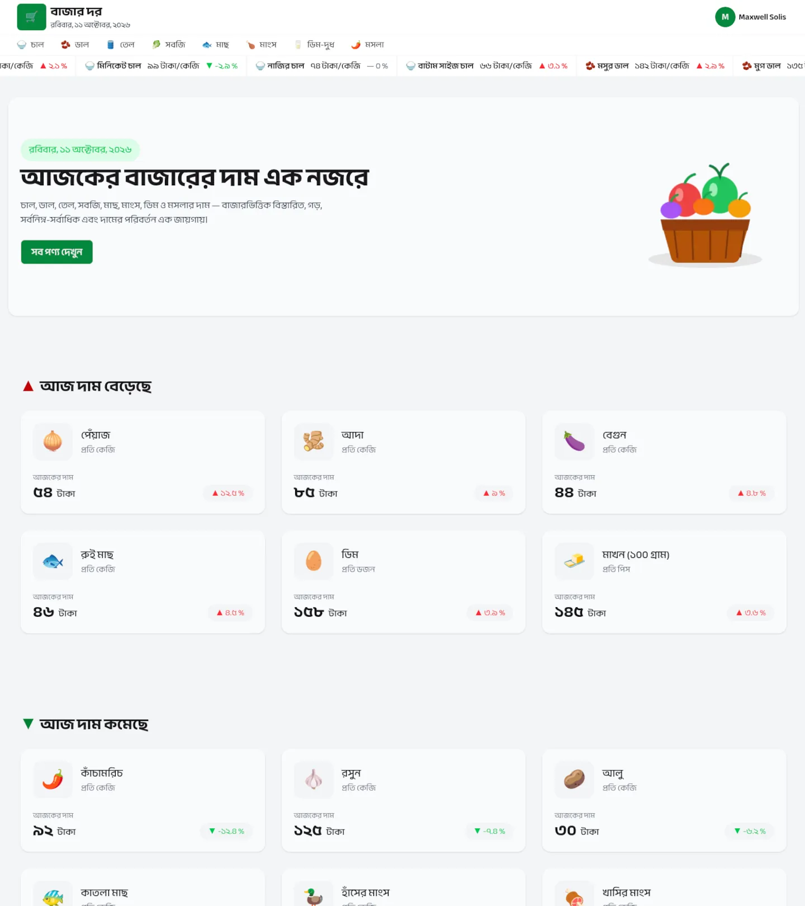
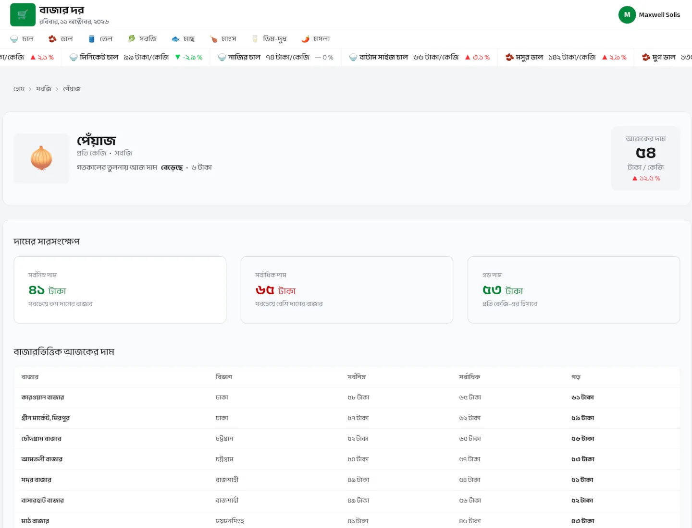
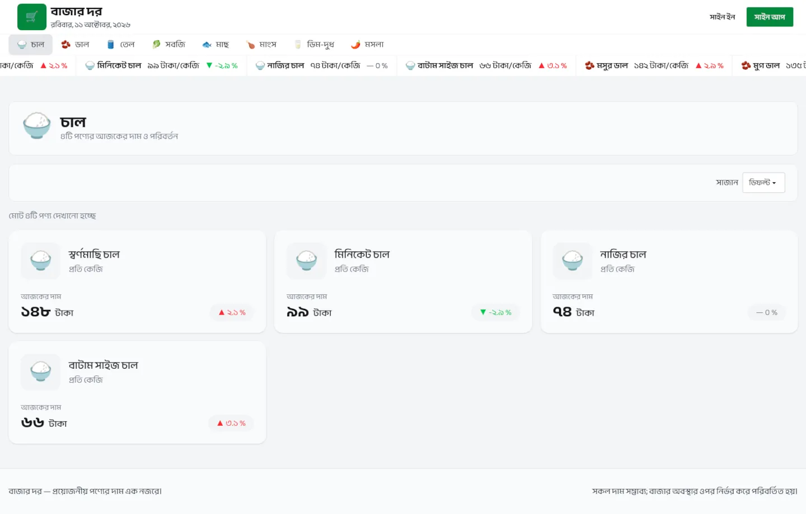
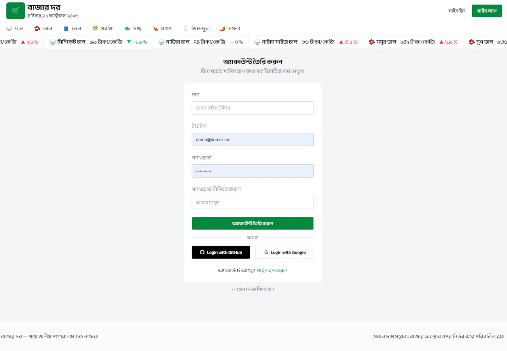

# BazarDor (বাজার দর)

Compare the prices of products in different Bazars and find the best deals. Sign in with Email, Google, or GitHub to get detailed information.

## Technologies used

- Next.js
- Tailwind CSS
- DaisyUI
- MongoDB
- Better-Auth
- React-Hot-Toast

## Features

- Compare prices of products in different bazars.
- View top products price rising and falling in bazar.
- Sign in with Email, Google and GitHub.
- Website is fully responsive and mobile friendly for all screen sizes.
- Skeleton loading of products for better user experience.
- Show proper errors messages using React Hot Toast.

## Project Dependencies

- Windows, MacOS, or Linux
- Node.js
- PNPM
- MongoDB
- Chrome or any other modern browser

## Run Locally

1. Clone the project

```bash
git clone https://github.com/shariult/b14-a07-bazar-dor.git
```

2. Navigate to the project directory

```bash
cd b14-a07-bazar-dor
```

3. Install dependencies

```bash
pnpm i
```

4. Copy "template.env" to ".env". To run in Development mode and set the environment variables in the ".env" file.

5. Run the project in development mode,

```bash
pnpm dev
```

## 📬 Let's Connect & Collaborate!

I am currently open to freelance projects, remote positions, and collaborative opportunities.

[](https://shariul.com) [](https://www.linkedin.com/in/shariul/) [](https://discord.gg/9q5GRgVS2)

## Screenshots








